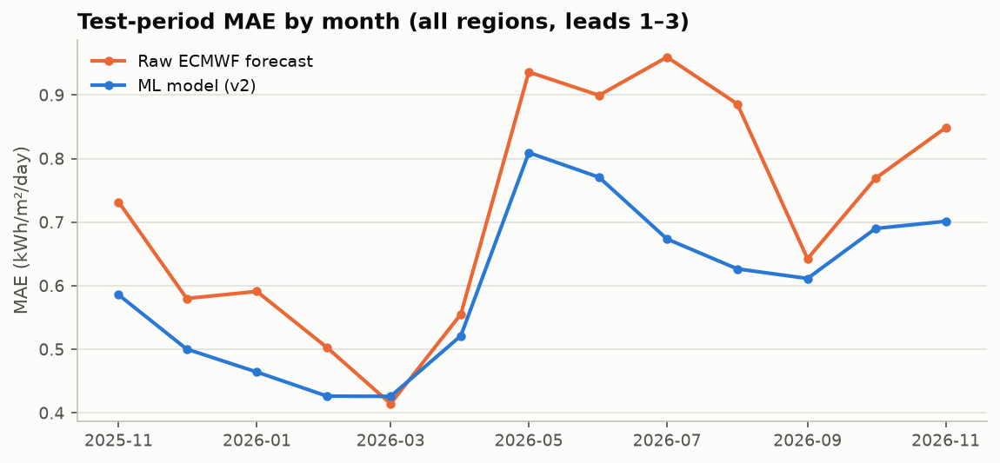

# Pudhuvai SolarScope

Three-day daily solar-radiation predictions for the four regions of the Union Territory of Puducherry: **Puducherry, Karaikal, Mahe and Yanam**. The predictions are shown on an interactive map and dashboard, with an indicative rooftop-energy calculator.

A machine-learning model corrects the ECMWF weather forecast (via [Open-Meteo](https://open-meteo.com/)). It learned the correction from archived forecasts paired with [NASA POWER](https://power.larc.nasa.gov/) satellite estimates of daily solar radiation.

**Model:** Random Forest regressor (scikit-learn) trained on archived ECMWF forecasts; inputs: forecast radiation, temperature (mean, max, min), humidity, precipitation, wind speed, lead time and season. Region identity and climatology features were tested but did not improve accuracy, so the selected model does not use them (see the [technical report](doc/technical_report.md), §6.4).

> **Educational decision-support tool.** Predictions are estimates from gridded data and models, not local measurements. They do not guarantee the output of any solar installation.



## Results at a glance

Scores are for a held-out test year (4 Nov 2025 – 3 Nov 2026), in kWh/m²/day:

| | MAE | RMSE | R² |
|---|---|---|---|
| **SolarScope model** (Random Forest) | **0.595** | **0.837** | **0.60** |
| Raw ECMWF forecast | 0.711 | 0.990 | 0.44 |
| Raw forecast minus average bias per region and lead | 0.624 | 0.888 | 0.55 |
| Long-term average (2001–2023 climatology) | 0.773 | 1.064 | 0.36 |

- **Overall:** error is 16 % lower than the raw forecast, about 12 % of a typical day's radiation.
- **By lead and region:** the model beats the raw forecast for every lead (1–3 days) and every region.
- **Category labels:** the low / moderate / high label matches NASA's on 68 % of days (raw forecast: 61 %).

Details are in the [technical report](doc/technical_report.md).

## Quick start

Tested with Python 3.14 on Windows. The commands below use the Windows `.venv\Scripts\` paths; on macOS/Linux use `.venv/bin/`.

```powershell
python -m venv .venv
.\.venv\Scripts\python -m pip install -r requirements.txt

# run the dashboard (opens http://localhost:8501)
.\.venv\Scripts\streamlit run src/dashboard/app.py
```

The repository includes the processed data, the boundary layers and the trained model, so the dashboard runs straight away. It only needs internet access to fetch the live forecast.

Live predictions on the command line:

```powershell
.\.venv\Scripts\python scripts/predict_live.py            # all regions
.\.venv\Scripts\python scripts/predict_live.py mahe yanam # selected regions
```

## What the dashboard shows

- **Map:** the four regions, coloured by tomorrow's availability category. Click a region to zoom in to its taluks, and click a taluk to select it.
- **Three-day outlook:** for each day, the ML estimate, its category (low < 5.0, moderate 5.0–6.0, high ≥ 6.0 kWh/m²/day) and the raw ECMWF forecast for comparison.
- **Rooftop energy estimate:** radiation × system capacity (kW) × performance ratio (default 0.75), clearly labelled as indicative.
- **Tabs:** region comparison, historical patterns (NASA 2001–2023), test-year accuracy, and data sources with limitations.
- **Status and warnings:** the page shows the forecast run time, retrieval time and model version. It warns when the forecast run is stale, inputs look unusual or a day is incomplete. If the forecast service fails, it shows an error instead of old values.

## Reproducing the pipeline

Each step writes outputs that the next step reads. Raw API responses are cached in `data/raw/`, which is git-ignored, so re-runs make no repeat calls.

| Step | Command | Output |
|---|---|---|
| 1. Archive audit | `python scripts/audit_archive_coverage.py` | `results/archive_audit/AUDIT_REPORT.md` |
| 2. Data collection (Modules 2–3) | `python scripts/collect_data.py` | `data/processed/nasa_solar_history.csv`, `archived_forecasts.csv` |
| 3. Preprocessing (Module 4) | run `notebooks/02_preprocessing.ipynb` | `solar_model_training.csv`, `climatology.csv` |
| 4. EDA and baselines (Module 5) | run `notebooks/03_eda_baselines.ipynb` | `results/eda/`, `results/baselines/` |
| 5. Model experiments (Module 6) | run `notebooks/04_model_experiments.ipynb` | `models/evaluated/`, `results/models/`, `results/metrics.json` |
| 6. Deployed model | `python scripts/retrain_production.py` | `models/solar_model.joblib`, `model_metadata.json` |
| 7. Map layers (Module 1) | `python scripts/prepare_geo.py --fetch` | `data/geo/*.geojson` |

To run a notebook from the command line: `.\.venv\Scripts\python -m jupyter nbconvert --to notebook --execute --inplace notebooks/02_preprocessing.ipynb`

Step 7 needs the geoBoundaries ADM3 file in `data/raw/geo/` (the script prints the download URL if it is missing). `--fetch` downloads the OpenStreetMap boundary relations into the same folder; leave it out to reuse the saved copy.

**Periodic retraining:** run step 2 and then step 6. This refits the chosen configuration on all labelled data, including newly published NASA days. The dashboard warns when the deployed model's training data is more than 120 days old.

## Tests

```powershell
.\.venv\Scripts\python -m pytest -q tests
```

There are 42 tests, all offline: the live API is replaced with synthetic data. They cover:

- daily aggregation and unit conversion;
- cleaning and split rules;
- train/inference consistency;
- the live engine's freshness, completeness and drift checks;
- API failure handling;
- the boundary layers and map clicks;
- the rooftop calculator;
- the dashboard itself.

## Project structure

```text
config/            locations.json (representative points), pipeline.json (all pipeline decisions)
data/processed/    datasets A, B, C, climatology
data/geo/          region and taluk boundaries (ODbL)
doc/               project description, technical report
models/            deployed model + metadata; evaluated/ = model whose test scores are reported
notebooks/         02 preprocessing, 03 EDA & baselines, 04 model experiments
results/           audit, EDA figures, baselines, model selection tables, metrics.json
scripts/           audit, collection, production refit, live prediction, map layers
src/
  data_collection/ NASA POWER and Open-Meteo Previous Runs clients, daily aggregation
  preprocessing/   cleaning, features, climatology, chronological splits
  models/          model definitions, evaluation metrics, live predictor
  services/        live Open-Meteo client, rooftop calculator
  geospatial/      boundary layers and Leaflet map
  dashboard/       Streamlit app
tests/             pytest suite
```

## Key design decisions

The [technical report](doc/technical_report.md) explains each of these.

- **Forecast model pinned to `ecmwf_ifs025`.** It has complete archives from March 2024. Open-Meteo's `best_match` can switch the underlying model, and ICON is being discontinued.
- **NASA labels use local solar time (LST) and forecasts use IST calendar days.** NASA's UTC daily series lags about 10 weeks; the LST series lags about 1 week; and the two give the same daily totals.
- **Forecast cloud cover is excluded.** ECMWF's archived cloud cover changed behaviour from late 2025, which made a model trained on 2024–25 under-predict.
- **There are two models.** The evaluated model (trained up to Nov 2025) supplies the reported accuracy. The deployed model is the same configuration refitted on all labelled data.
- **Region-aware vs location-blind.** The ablation found no reliable gain from region features with the current 2.7 years of data, so the protocol selected a location-blind model.

## Data sources, licences and attribution

- **NASA POWER:** daily `ALLSKY_SFC_SW_DWN` and related variables. NASA Langley Research Center (LaRC) POWER Project, funded through the NASA Earth Science/Applied Science Program.
- **Open-Meteo:** Previous Runs API and Forecast API, ECMWF IFS 0.25° model. Data licensed under CC BY 4.0. The free API is for **non-commercial** use; check [Open-Meteo's terms](https://open-meteo.com/en/terms) before any public or commercial deployment.
- **Boundaries:** © [OpenStreetMap](https://www.openstreetmap.org/copyright) contributors (taluk and district relations, the same boundaries the base map draws). The Karaikal/Thirunallar split comes from [geoBoundaries](https://www.geoboundaries.org/) gbOpen IND ADM3 (Local Government Directory via Pathways Data Pvt. Ltd.). Both are ODbL 1.0; the derived files in `data/geo/` are also ODbL 1.0.
- **Base map:** © OpenStreetMap contributors.

## Limitations

- **Spatial resolution:** each region is represented by one point, and NASA solar data is on a ~1° grid. All taluks of a region therefore show the same values.
- **The target is an estimate:** NASA POWER is a satellite estimate, not a ground pyranometer measurement.
- **Typical error:** about ±0.6 kWh/m²/day, larger during the monsoons. Only about 2.7 years of archived forecasts exist so far.
- **Input drift:** forecast inputs can change when the weather model is upgraded. The live engine checks inputs against the training data.
- **Rooftop estimate:** the calculator ignores tilt, orientation, shading and equipment specifics.
