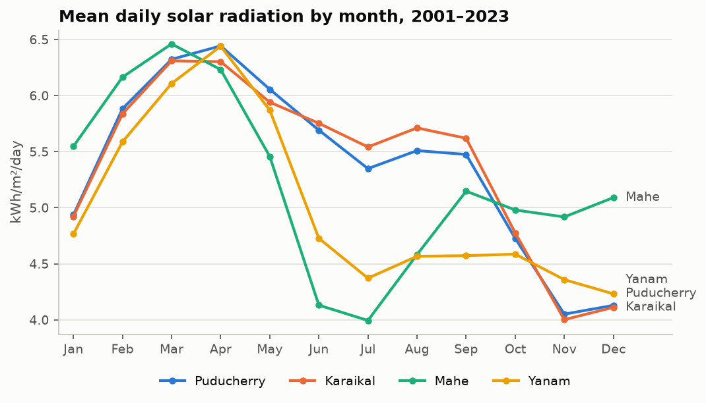
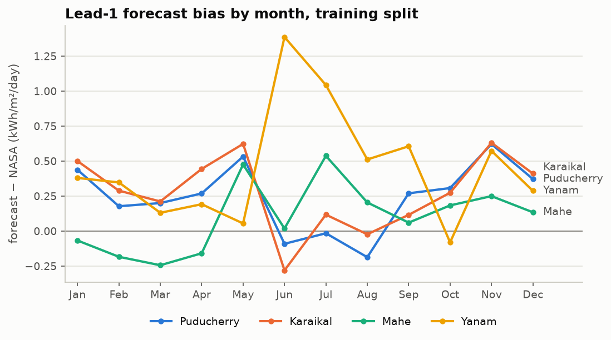
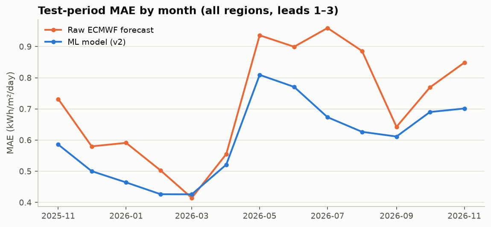

# Pudhuvai SolarScope: Technical Report

*Machine-learning correction of three-day solar-radiation forecasts for the four regions of the Union Territory of Puducherry*

**Report date:** November 2026.

All radiation values are daily global horizontal irradiation in kWh/m²/day, and all accuracy figures are from a held-out test year unless stated otherwise.

---

## Abstract

Pudhuvai SolarScope estimates daily solar radiation for the next three days in Puducherry, Karaikal, Mahe and Yanam, and shows the estimates on an interactive map with an indicative rooftop-energy calculator.

**Method.** A supervised model learns how to correct the ECMWF IFS 0.25° forecast, using archived forecasts from Open-Meteo's Previous Runs API as inputs and NASA POWER satellite estimates as labels. Training examples are built to match what is available at prediction time: forecasts issued 1, 2 and 3 days before each target date.

**Data.** Only about 2.7 years of archived forecasts exist (March 2024 – November 2026).

**Selection and evaluation.** The candidate models were compared on a validation period. The selected configuration was then scored on a held-out test year (November 2025 – November 2026) against:
- the raw forecast;
- a bias-corrected version of the raw forecast;
- a 2001–2023 climatology.

**Results.** The final model, a Random Forest, achieved:

| Test year | MAE | R² |
|---|---|---|
| Final model | **0.595** | 0.60 |
| Raw forecast | 0.711 | 0.44 |

That is a 16 % reduction in error, and the model improves on the raw forecast for every lead time and every region.

**Two findings shaped the result:**
1. **Input drift.** ECMWF's archived cloud-cover forecasts changed behaviour from late 2025. A model that used them under-predicted, so the variable was excluded.
2. **Regional ablation.** Explicit region features did not reliably improve accuracy with the data available, even though the regions have clearly different seasonal regimes.

## 1. Introduction

### 1.1 Problem

Rooftop-solar planning needs location-specific information on expected solar radiation. General weather forecasts do not translate directly into that.

The Union Territory of Puducherry is an unusual case. It has four regions hundreds of kilometres apart, on both coasts of southern India, with different monsoon regimes:
- **Puducherry and Karaikal** on the Coromandel coast;
- **Mahe**, a small enclave on the Malabar coast in Kerala;
- **Yanam** in the Godavari delta in Andhra Pradesh.

### 1.2 Objectives

1. Collect historical NASA POWER solar radiation and archived Open-Meteo forecasts for the four regions.
2. Build training examples that match forecast availability at prediction time.
3. Train and compare regression models using chronological splits, against honest baselines.
4. Predict the next three days from live forecasts, with checks for data quality and freshness.
5. Present the predictions on an interactive map and dashboard, with an indicative rooftop-energy estimate.

The full project specification is [solar_prediction_puducherry_project_description.md](solar_prediction_puducherry_project_description.md).

## 2. Study area and data

### 2.1 Representative points

Each region is represented by one point, placed slightly inland so that it does not fall in an ocean-dominated grid cell. The points are defined in `config/locations.json`.

| Region | Point (lat, lon) | Open-Meteo / ECMWF cell | NASA 1° solar cell |
|---|---|---|---|
| Puducherry | 11.93, 79.80 | 12.00, 79.75 | 11°N 79°E |
| Karaikal | 10.92, 79.82 | 11.00, 79.75 | 10°N 79°E |
| Mahe | 11.70, 75.54 | 11.75, 75.50 | 11°N 75°E |
| Yanam | 16.73, 82.21 | 16.75, 82.25 | 16°N 82°E |

No two regions share a NASA cell, and no two regions ever have identical daily NASA values. All taluks within a region share that region's values, and the dashboard says so.

### 2.2 Sources

| Role | Source | Detail |
|---|---|---|
| Labels and climatology | NASA POWER Daily Point API | `ALLSKY_SFC_SW_DWN`, plus `CLRSKY_SFC_SW_DWN`, temperature, humidity, precipitation and wind; 2001-01-01 to 2026-11-03; **LST** time standard |
| Training inputs | Open-Meteo Previous Runs API | `ecmwf_ifs025`; hourly shortwave radiation, cloud cover, temperature, humidity, precipitation and wind; `_previous_day1..3`; March 2024 to November 2026 |
| Live inputs | Open-Meteo Forecast API | same model, variables and UTC hours as the training inputs |
| Boundaries | geoBoundaries gbOpen IND ADM3 | the 8 official taluks, from the Local Government Directory; ODbL 1.0 |

## 3. Data audit

Before any modelling, `scripts/audit_archive_coverage.py` measured how far back the Open-Meteo archive goes. It scanned eight candidate weather models from 2018 to the present, at all four points, for six variables and three lead days. The full output is `results/archive_audit/AUDIT_REPORT.md`.

| Model | Continuous coverage from | Lead-1 MAE vs NASA | Decision |
|---|---|---|---|
| `ecmwf_ifs025` | April 2024 (complete days from about 9 March 2024) | 0.64 | **Selected (pinned)** |
| `best_match` | February 2024 | 0.63 | Rejected: Open-Meteo chooses its underlying model and can change it |
| `icon_seamless` | February 2024 | 0.63 | Rejected: ICON Global is discontinued on 30 Nov 2026 |
| `gfs_seamless` | February 2024 | 1.05 | Rejected: much less accurate |
| GEM, ARPEGE | mid-2026 | – | Archive too short |
| JMA GSM, UKMO | – | – | Required variables not available |

**Other audit findings:**

- **ECMWF has one gap.** Its only outage in the archive is a 6-day gap on 17–22 April 2026.
- **The archive returns genuine older forecasts.** About 91 % of lead-1 daylight hours differ from the latest run, so the archive is not copying current values.
- **NASA time standard.** NASA's **UTC** daily series lagged real time by about 10 weeks (latest valid date 31 August 2026), while the **LST** series lagged about 1 week (3 November 2026). Over 943 overlapping days, the two daily totals differed by at most 0.001 kWh/m²/day on average. In India both day boundaries fall at night, which explains why. The project therefore uses LST for NASA and IST calendar days for forecast aggregation, which adds about two months of usable labels.

## 4. Data preparation

### 4.1 Daily aggregation and lead time

**Daily aggregation.** Hourly forecasts are fetched in UTC, shifted by +05:30 and grouped into IST calendar days.
- Daily radiation is the sum of the 24 hourly means (W/m²) divided by 1000, giving kWh/m²/day.
- The other variables are daily means, maxima, minima or sums.
- A day counts only if all 24 hours are present for every variable.

**Lead time.** In the archive, `_previous_dayN` is defined per hour: each hourly value was predicted N × 24 hours before that hour. A "lead-N" daily total is therefore assembled from several runs, and its nominal issue date is the target date minus N.

A live forecast for "tomorrow" comes from the latest run and is predicted about 18–48 hours ahead. That is close to the archived definition but not identical. This approximation is documented, and the train/inference consistency test (§10) confirms that both paths use identical transformations.

### 4.2 Cleaning

**Rules applied** (`src/preprocessing/clean_data.py`):
- values are clipped to physical bounds, for example precipitation ≥ 0, since ECMWF occasionally outputs −0.3 mm;
- humidity and cloud cover are kept within 0–100 %;
- incomplete forecast days are dropped, not imputed;
- missing or out-of-range NASA targets are dropped.

**What was removed:**
- **Forecast rows:** 160 dropped, from the archive's start in early March 2024 and the April 2026 outage.
- **NASA:** no missing target values in 37,752 rows (2001–2026).

### 4.3 Features

| Group | Features |
|---|---|
| Forecast (daily) | shortwave radiation, temperature mean/max/min, humidity mean, cloud cover mean, precipitation sum, wind speed mean |
| Lead | `lead_days` (1–3) |
| Season | `doy_sin`, `doy_cos` (cyclical day of year) |
| Climatology | the region's smoothed NASA mean for that day of year (all-sky and clear-sky), **computed from 2001–2023 only**, before the training period; region-aware variants only |
| Region | `region_id` (one-hot), in region-aware variants only |

The final model is location-blind (§6.4), so it uses only the forecast, lead and season features, without cloud cover (§6.3).

Fitted transforms (one-hot encoding, scaling) sit inside the model pipeline and are fitted on training rows only.

### 4.4 Chronological splits

Splits are by target date, so all three lead rows of a date are always in the same split. The test period covers a full 12 months, so every region's monsoon season is included.

| Split | Target dates | Days | Rows |
|---|---|---|---|
| Train | 2024-03-07 → 2025-05-03 | 423 | 5,060 |
| Validation | 2025-05-04 → 2025-11-03 | 184 | 2,208 |
| Test | 2025-11-04 → 2026-11-03 | 358 | 4,296 |

## 5. Exploratory analysis

Exploratory analysis of the relationship between forecasts and the target used the training split only. The full analysis is `notebooks/03_eda_baselines.ipynb`.

### 5.1 Distinct seasonal regimes

| Region | Low-sun season | Typical low (kWh/m²/day) | Cause |
|---|---|---|---|
| Puducherry, Karaikal | Nov–Dec | about 4.0 | north-east monsoon |
| Mahe | Jun–Jul | about 4.0 | south-west monsoon |
| Yanam | Jun–Dec | 4.2–4.7 | south-west monsoon, then the post-monsoon and cyclone season |

The order of the regions changes with the season. Mahe is about 1.5 kWh/m²/day *below* Karaikal in July, but about 1 kWh/m²/day *above* Puducherry in December. Year-to-year variability is highest in each region's monsoon months.

### 5.2 Three effective climate regimes

After removing the shared seasonal cycle, daily anomalies at Puducherry and Karaikal are strongly correlated (r = 0.85). Mahe and Yanam are only weakly correlated with each other and with the eastern regions (r = 0.18–0.37).

### 5.3 Region- and season-specific forecast bias

Raw ECMWF over-forecasts overall, by +0.26 on the training split, but the pattern differs by region and season:
- **Yanam:** +1.0 to +1.4 in June–July;
- **Mahe:** about −0.2 from January to April;
- **Puducherry and Karaikal:** about +0.5 to +0.6 in May and November.

### 5.4 Feature relationships

**With the target:** forecast shortwave radiation is the strongest single predictor (r = 0.81), followed by climatology (0.69) and cloud cover (−0.68).

**With the residual** (NASA minus raw forecast): no variable is more than weakly correlated (|r| ≤ 0.15). So any gain over the raw forecast has to come from non-linear effects and interactions.

### 5.5 Upward bias drift

The raw forecast's bias grew from +0.26 (train) to +0.32 (validation) and +0.45 (test).

## 6. Modelling

### 6.1 Candidates and protocol

**Candidate models:**
- **Linear:** ridge regression; region-aware variants include region × forecast interaction terms;
- **Random Forest;**
- **XGBoost.**

**Targets:** each candidate was trained with two targets: the NASA value directly, or the residual (NASA − raw forecast), with the raw forecast added back afterwards.

**Protocol**, the same for every run (`notebooks/04_model_experiments.ipynb`):
1. Tune on **train** and score on **validation** (small grids: 4 for linear, 18 for Random Forest, 24 for XGBoost), using region-aware features.
2. Run the regional ablation with each model's best settings: location-blind (no region or climatology features), region-aware, and one model per region.
3. Select the configuration with the lowest validation MAE. It must beat the raw forecast on validation.
4. Refit it on **train + validation** and score it **once** on **test**.

### 6.2 First run (v1, all features)

v1 selected a region-aware ridge regression, with validation MAE 0.727 (raw forecast: 0.785). On test it reduced error by 8 % (MAE 0.654), but its **bias flipped to −0.19**, while the raw forecast was +0.45. A simple per-region, per-lead bias correction of the raw forecast scored better (MAE 0.624).

### 6.3 Diagnosis: archived cloud-cover drift

Each forecast input was compared with the same calendar months a year earlier. This used **inputs only, no labels**, which is a check a live system can also run.

Mean forecast cloud cover (%), lead 1, all regions:

| Year | Jan | Feb | Mar | Apr | May | Jun | Jul | Aug | Sep | Oct | Nov | Dec |
|---|---|---|---|---|---|---|---|---|---|---|---|---|
| 2024 | – | – | 6 | 10 | 37 | 61 | 69 | 64 | 49 | 50 | 43 | 43 |
| 2025 | 22 | 6 | 13 | 16 | 41 | 56 | 62 | 62 | 55 | 57 | 54 | 49 |
| 2026 | 37 | 36 | 22 | 38 | 60 | 75 | 90 | 86 | 68 | 66 | 83 | – |

**The size of the shift.** Over April–October, cloud cover rose by **0.59 standard deviations** from 2025 to 2026, against 0.04 the year before.

**Why it is not real weather.** Over the same months, forecast radiation **also rose** (+0.39 sd) and NASA radiation rose too. More cloud with more sunshine is physically inconsistent.

**Cause.** A change in how the ECMWF cloud-cover field is produced or delivered is the likely explanation, such as a model-cycle upgrade or a processing change. The exact cause was not confirmed.

**Effect.** v1 had learned "more cloud means less sun" from 2024–25, so it under-predicted in 2026. Live forecasts in November 2026 show the same inflated cloud values, so v1 would have been wrong in deployment regardless of its test score.

**Decision.** `forecast_cloud_cover_mean` was removed and the identical protocol was re-run (v2). The other inputs shifted in ways that fit a warmer, sunnier 2026 and were kept. The v1 result is still reported.

### 6.4 Second run (v2, without cloud cover)

Regional ablation, validation MAE:

| Model · target | Location-blind | Region-aware | Per-region |
|---|---|---|---|
| Linear · direct | 0.747 | 0.746 | 0.763 |
| Linear · residual | 0.747 | 0.745 | 0.751 |
| Random Forest · direct | **0.732** | 0.750 | 0.776 |
| Random Forest · residual | 0.737 | 0.736 | 0.770 |
| XGBoost · direct | 0.736 | 0.744 | 0.781 |
| XGBoost · residual | 0.735 | 0.736 | 0.766 |

**Selected:** a location-blind **Random Forest** (scikit-learn `RandomForestRegressor`), direct target (`max_depth=6`, `min_samples_leaf=5`, `max_features=0.6`, 400 trees), with validation MAE 0.732.

**Its 10 inputs:**
- forecast shortwave radiation;
- forecast temperature (mean, max, min);
- humidity;
- precipitation;
- wind speed;
- `lead_days`;
- `doy_sin` and `doy_cos`.

It has no region, climatology or cloud-cover inputs. XGBoost (best validation MAE 0.735) and linear regression (0.745) were the runners-up.

**On the regional ablation:**
- Region-aware and location-blind variants are within ±0.02 of each other, which is within noise.
- Per-region models are consistently worst, because they split about 420 training days four ways.
- This does not contradict §5. The forecast inputs already differ between regions, and with one training year per season the explicit region features add little on top of them.
- The comparison should be repeated as the archive grows.

**Feature importance (final model):**

| Feature | Importance |
|---|---|
| Forecast shortwave radiation | 0.665 |
| Precipitation | 0.118 |
| Seasonal term (`doy_sin`) | 0.105 |
| Humidity | 0.032 |

`lead_days` has an importance of about 0: the lead-dependent information is already carried by the forecast values themselves.

## 7. Results

### 7.1 Test year, overall

| | MAE | RMSE | R² | Bias |
|---|---|---|---|---|
| **Final model (v2)** | **0.595** | **0.837** | **0.602** | +0.10 |
| v1 (all features) | 0.654 | 0.854 | 0.585 | −0.19 |
| Raw ECMWF forecast | 0.711 | 0.990 | 0.442 | +0.45 |
| Bias-corrected forecast | 0.624 | 0.888 | 0.552 | +0.17 |
| Climatology 2001–2023 | 0.773 | 1.064 | 0.356 | +0.08 |

The final model is best on every metric. In relative terms:
- MAE is **11.6 %** of the mean daily radiation (5.15), and RMSE is 16.3 %.
- Skill against climatology is 23 % (MAE).
- The median absolute error is 0.43, the 80th percentile is 0.89, and 7 % of days are off by more than 1.5.

### 7.2 By lead time and region (test MAE)

| | Final model | Raw forecast | Bias-corrected | Change vs raw |
|---|---|---|---|---|
| Lead 1 | 0.542 | 0.651 | 0.565 | −17 % |
| Lead 2 | 0.604 | 0.729 | 0.637 | −17 % |
| Lead 3 | 0.640 | 0.754 | 0.671 | −15 % |
| Puducherry | 0.568 | 0.680 | 0.588 | −16 % |
| Karaikal | 0.589 | 0.684 | 0.601 | −14 % |
| Mahe | 0.550 | 0.646 | 0.627 | −15 % |
| Yanam | 0.675 | 0.835 | 0.681 | −19 % |

### 7.3 By season

| Season (test year) | MAE | % of mean |
|---|---|---|
| Jan–Apr (dry) | 0.46 | 8 % |
| May–Sep (south-west monsoon) | 0.70 | 13 % |
| Oct–Dec (north-east monsoon) | 0.60 | 14 % |

The model improves on the raw forecast in 12 of the 13 test months (the exception is March 2026: 0.43 vs 0.42). The largest gains are in the monsoon months: for example, July 2026 MAE is 0.67 against 0.96. The model's bias is still positive and grows towards the end of the test year (+0.25 in November 2026).

### 7.4 Availability categories

The categories follow a project rule: the lower and upper thirds of NASA daily values for 2001–2023, rounded:

| Category | Daily radiation (kWh/m²/day) |
|---|---|
| Low | below 5.0 |
| Moderate | 5.0 to under 6.0 |
| High | 6.0 and above |

On the test year, the predicted category matches NASA's on **68 %** of days (raw forecast: 61 %). It is off by two categories (low ↔ high) on 2.2 % of days (raw forecast: 4.0 %).

### 7.5 Interpretation

An error of about 0.6 kWh/m²/day (12 %) is reasonable for a day-ahead forecast in a monsoon climate. Two things put a floor under it:
- **Cloud predictability.** Clouds one to three days ahead are hard to forecast for any weather model.
- **The target itself.** NASA POWER is a satellite estimate over a 1° cell and has its own error against ground stations, so no model trained on it can be more accurate than that.

The main lever for improvement is more archive years, which accumulate automatically (§12).

## 8. Deployed system

### 8.1 Evaluated and deployed models

| Model | Location | Trained on | Role |
|---|---|---|---|
| Evaluated | `models/evaluated/` | train + validation, up to 2025-11-03 | Source of all reported accuracy figures |
| Deployed | `models/solar_model.joblib` | all 11,564 labelled rows, up to 2026-11-03 | Used by the live engine |

The deployed model is the same configuration, refitted by `scripts/retrain_production.py`. It has no held-out test of its own, and its metadata says so. Over the last 60 days its predictions are on average 0.06 lower than the evaluated model's, reflecting the larger 2026 bias it has now seen.

### 8.2 Live prediction engine

The live engine is `src/models/predict.py`. It passes live forecasts through exactly the training transformations (aggregation, then cleaning, then features, then the saved pipeline) and adds these checks:

| Check | Behaviour |
|---|---|
| Open-Meteo request fails | Clear error; no old values are shown |
| Incomplete forecast day | That day is marked "unavailable" |
| Forecast run older than 18 h | Warning (run time from the Open-Meteo model metadata) |
| Live grid cell differs from training | Warning |
| An input more than 3 sd from the training data (same region, ±30 days) | Prediction marked "check inputs"; cloud cover is monitored but not used |
| Model trained on data more than 120 days old | Warning to retrain |

Each prediction is logged with its metadata to `data/predictions/prediction_log.csv`, so it can be evaluated once NASA labels arrive.

### 8.3 Dashboard and calculator

The dashboard is built with Streamlit, a Leaflet map (via folium) and Plotly charts.

- **Map:** the four regions are coloured by tomorrow's category. Clicking a region shows its taluks, which can also be selected.
- **Forecast panel:** three day cards, each with the ML estimate, category and raw forecast.
- **Tabs:** region comparison, historical patterns, test-year accuracy, and data and attribution notes.

**Boundaries.** The 8 taluks come from geoBoundaries ADM3 (Local Government Directory). Region outlines are built by merging taluks, because the district (ADM2) layer wrongly places Thirunallar (Karaikal) inside Puducherry. The source outline for Yanam (about 13 km²) is smaller than the officially cited about 30 km²; this affects the map only.

**Rooftop calculator.** Energy = radiation × capacity (kWp) × performance ratio. Defaults are 3 kW and PR 0.75, adjustable from 0.60 to 0.90. Results are labelled as indicative, horizontal-surface estimates.

## 9. Reproducibility

- **Settings:** all pipeline decisions (forecast model, variables, splits, climatology years, live checks, categories, calculator defaults) are in `config/pipeline.json`.
- **Raw data:** raw API responses are cached with their request parameters and retrieval times.
- **Determinism:** models use fixed random seeds, and re-running the notebooks reproduces the reported figures.
- **Instructions:** the README lists the pipeline steps in order.

## 10. Testing

There are 42 automated tests (`pytest`), all offline. The live API is replaced with synthetic data.

| Area | Examples |
|---|---|
| Data processing | UTC → IST daily aggregation; W/m² → kWh conversion; incomplete days give missing values, not partial sums; leads kept separate |
| Preprocessing | all leads of a date share a split; climatology uses only its stated years; cyclical season; clipping and drop rules |
| Train/inference consistency | the live path produces the same features and prediction as the training path on identical hourly data |
| Live engine | 3 days × 4 regions; incomplete day → unavailable; stale run and grid mismatch warnings; API failure raises a clear error; metadata failure is non-fatal; drift flags only on inputs the model uses |
| Model metadata | the listed features match the inputs each saved pipeline actually uses |
| Geography | the 8 official taluks; representative points inside regions; areas close to official figures; map-click mapping |
| Calculator | formula, linearity, missing radiation, invalid inputs |
| Dashboard | overview renders; region and taluk selection; calculator updates; API failure shows an error and no values |

The dashboard was also checked by hand in a headless browser: overview, region, taluk, all four tabs, and clicking on the map.

## 11. Limitations

1. **Spatial resolution.** Each region has one representative point and NASA uses a ~1° grid, so taluk values are identical within a region. The values are not street- or rooftop-level.
2. **Label uncertainty.** NASA POWER is a satellite-derived gridded estimate, not a ground measurement.
3. **Short archive.** About 2.7 years of forecasts means each monsoon has been seen only 2–3 times. Both the regional ablation and the monthly bias estimates rest on little data.
4. **Non-stationary inputs.** The weather model's outputs can change behaviour, as cloud cover did. The raw forecast's bias drifted upward from 2024 to 2026.
5. **Lead-time approximation.** Archived "lead-N" days are assembled from several runs, while live forecasts come from a single run.
6. **Calculator simplifications.** The calculator uses horizontal-surface radiation and a single performance ratio. It ignores tilt, orientation, shading and equipment specifics.
7. **Licensing.** Open-Meteo's free API is for non-commercial use, so public deployment needs a terms check.

## 12. Future work

- **Retrain regularly** (`collect_data.py` then `retrain_production.py`) and evaluate the logged live predictions against NASA labels as they arrive.
- **Show uncertainty ranges** on each prediction, based on the test-year error distribution by season, for example ±0.5 in the dry season and ±0.7 in the monsoon.
- **Repeat the regional ablation** once three or more years of archive are available.
- **Blend a second weather model**, such as GFS, while monitoring its inputs for drift.
- **Use higher-resolution data:** satellite irradiance or ground pyranometers for validation, and a full PV-yield model with tilt and orientation.

## 13. Conclusion

A modest Random Forest trained on archived ECMWF forecasts reduces daily solar-radiation forecast error by 16 % on a held-out year. The improvement holds for all four regions of Puducherry and all three lead days. The model also beats a simple bias correction and a long-term climatology.

The project's main lessons are about data rather than algorithms:
- **Check what the archive actually provides,** and how fresh the labels are, before modelling. This changed the choice of model and time standard.
- **Treat forecast inputs as able to drift.** Doing so caught a cloud-cover change that would have degraded the deployed model.
- **Test assumptions such as regional modelling** instead of building them in. With the current data, the expected benefit of region-aware modelling did not materialise.

The resulting system makes honest, clearly labelled three-day estimates available on a map-based dashboard.

---

### Appendix A: Key files

| Purpose | File |
|---|---|
| Archive audit | `scripts/audit_archive_coverage.py`, `results/archive_audit/AUDIT_REPORT.md` |
| Data collection | `scripts/collect_data.py`, `src/data_collection/` |
| Preprocessing | `notebooks/02_preprocessing.ipynb`, `src/preprocessing/`, `results/preprocessing/data_quality.json` |
| EDA and baselines | `notebooks/03_eda_baselines.ipynb`, `results/eda/`, `results/baselines/` |
| Model selection | `notebooks/04_model_experiments.ipynb`, `src/models/train.py`, `results/models/`, `results/metrics.json` |
| Deployed model | `scripts/retrain_production.py`, `models/` |
| Live engine | `src/services/live_forecast.py`, `src/models/predict.py`, `scripts/predict_live.py` |
| Map and dashboard | `scripts/prepare_geo.py`, `src/geospatial/map_data.py`, `src/dashboard/app.py` |
| Calculator | `src/services/rooftop.py` |
| Tests | `tests/` |

### Appendix B: Data attribution

- NASA POWER: NASA Langley Research Center (LaRC) POWER Project, funded through the NASA Earth Science/Applied Science Program.
- Open-Meteo: weather data under CC BY 4.0 (ECMWF IFS model).
- geoBoundaries gbOpen IND ADM3: Local Government Directory via Pathways Data Pvt. Ltd., ODbL 1.0.
- Base map: © OpenStreetMap contributors.
